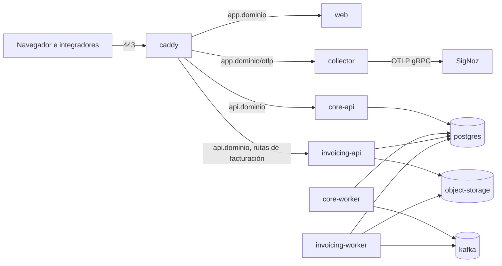

# Despliegue en producción

El stack de producción de Faclab en un VPS con Docker Compose (S8.1, ADR-0011 del core). Esta guía
lleva un servidor Ubuntu 24.04 limpio hasta el sistema funcionando, con TLS y una venta facturada en
el SRI.

## Qué se despliega



| Servicio | Imagen | Para qué | Memoria |
|---|---|---|---|
| `caddy` | `caddy:2.11.9` con `caddy-ratelimit` (`caddy/Dockerfile`) | TLS, rutas por dominio y ruta, límites por IP y de tamaño, cabeceras de seguridad. El único con puertos publicados: 80, 443 y 443/udp | 128 MB |
| `web` | faclab-web | La aplicación (SPA), con su `config.js` escrito al arrancar | 64 MB |
| `core-api`, `core-worker` | faclab-core | El API (2 procesos de uvicorn) y el worker (outbox, consumidor de Kafka, webhooks, tareas) | 768 y 512 MB |
| `invoicing-api`, `invoicing-worker` | faclab-invoicing | El API y el worker que habla con el SRI | 384 y 512 MB |
| `postgres` | `postgres:17.12` | Las bases `faclab` (core) y `faclab_invoicing` | 1,5 GB |
| `kafka` | `confluentinc/cp-kafka:7.9.0` | KRaft, un nodo, solo en la red interna | 1 GB |
| `kafka-topics` | la de Kafka | Crea los tópicos y termina | — |
| `object-storage` | `dxflrs/garage:v2.4.1` | XML, RIDE y logos de facturación (compatible con S3, D-2) | 256 MB |
| `collector`, `docker-socket-proxy` | `otel/opentelemetry-collector-contrib:0.165.0` | Telemetría de los servicios y del navegador, métricas de infraestructura, envío a SigNoz | 512 MB |
| `core-migrate`, `invoicing-migrate` | las de core e invoicing | Migraciones, como tareas únicas (perfil `tasks`) | — |

Archivos de esta carpeta:

| Archivo | Qué es |
|---|---|
| `compose.yaml` | El stack. Usa además `scripts/create-topics.sh`, `scripts/init-invoicing-db.sh`, `garage/garage.toml` y `observability/otel-collector/config.yaml` de la raíz del repositorio |
| `compose.build.yml` | Construye core, invoicing y web desde sus repositorios públicos en una ref fija, mientras S8.2 no las publique en GHCR |
| `caddy/` | La imagen de Caddy, el `Caddyfile` y los dos modos de TLS |
| `otel-collector.yaml` | Lo que cambia del Collector en producción (una sola instancia de PostgreSQL, `health_check`) |
| `env/staging.env`, `env/production.env.example` | La configuración de cada entorno que no es secreta |
| `secrets.env.example`, `sops.yaml.example` | Los nombres de los secretos y el formato de `.sops.yaml`, sin valores |
| `scripts/provision-vps.sh` | Prepara el servidor |
| `scripts/secrets.sh` | Genera, edita y envía los secretos (en tu máquina) |
| `scripts/stack.sh` | Instala, migra, levanta y revisa el stack (en el servidor) |
| `scripts/smoke.sh` | Prueba de humo desde fuera |
| `scripts/ci-validate.sh` | Lo que valida el CI, sin servidor |

### Decisiones

- **Dominios (D-9).** `app.<dominio>` sirve la web y `/otlp`; `api.<dominio>` sirve el core y manda a
  faclab-invoicing `/api/v1/invoices*`, `/api/invoices*`, `/api/invoicing*`, `/api/certificates*`,
  `/api/company-config*` y `/api/sequences*`. La documentación pública queda en
  `api.<dominio>/docs/public`. Al ser subdominios del mismo dominio, la cookie de sesión
  (`SameSite=Strict`) funciona.
- **Una sola instancia de PostgreSQL** con dos bases, cada una con sus roles: `faclab_owner`,
  `faclab_app`, `faclab_worker` y `faclab_monitor` en `faclab` (los crea `db_roles` del core);
  `faclab_invoicing` en `faclab_invoicing`.
- **Kafka sin TLS ni SASL, solo en la red interna** `data`: sin puertos publicados ni kafka-ui. Basta
  mientras Kafka no salga del servidor (G-49).
- **Imágenes construidas en el servidor** desde Git en una ref fija (`*_REF`, mejor un SHA o una
  etiqueta) hasta que S8.2 las publique.

## Requisitos

- **Servidor:** Ubuntu 24.04 LTS, 4 vCPU, 8 GB de RAM y 80 GB de disco, con IPv4 pública y acceso
  root por SSH o consola la primera vez.
- **Dominio:** dos registros A, `app.<dominio>` y `api.<dominio>`, hacia la IP del servidor.
- **Tu máquina:** `ssh`, `sops`, `age` y un OpenSSL que genere llaves Ed25519 (en macOS:
  `brew install sops age openssl@3`; el OpenSSL del sistema es LibreSSL y no las genera).

## 1. Aprovisionar el servidor

Como root en el servidor, una sola vez (es idempotente):

```bash
curl -fsSLO https://raw.githubusercontent.com/faclab-ec/faclab-infra/master/deploy/production/scripts/provision-vps.sh
less provision-vps.sh   # léelo antes de correrlo
bash provision-vps.sh deploy "ssh-ed25519 AAAA... tu-llave"
```

Desde tu máquina también puedes pasarlo por stdin, sin descargarlo:
`ssh root@<ip> bash -s -- deploy "$(cat ~/.ssh/id_ed25519.pub)" < scripts/provision-vps.sh`.

Lo que hace:

- crea el usuario `deploy` con tu llave, `sudo` sin contraseña y el grupo `docker`;
- SSH solo con llave y sin root;
- ufw: entra solo 22, 80, 443 y 443/udp;
- actualizaciones de seguridad automáticas, sin reinicios automáticos;
- Docker Engine y el plugin de Compose desde el repositorio de Docker, con logs rotados y
  `mirror.gcr.io` como espejo de Docker Hub (`DOCKER_REGISTRY_MIRROR=` lo quita);
- los búferes UDP que pide HTTP/3;
- `/opt/faclab` para el repositorio y `/etc/faclab` (root, 0700) para los secretos.

Comprueba, desde otra terminal y antes de cerrar la sesión de root, que entras como `deploy` y que
root ya no entra.

> **Docker Hub.** Sin cuenta, Docker Hub da 10 descargas por hora a cada IP, y la primera instalación
> necesita una docena de imágenes: en staging se agotó el límite a mitad de `stack.sh install`. El
> espejo de Google resuelve la mayoría, y lo que no tiene sale de Docker Hub. Si aun así se agota,
> espera una hora y repite `stack.sh install` (sigue donde quedó), o entra con una cuenta de Docker
> Hub en el servidor (`sudo docker login`, 100 descargas por hora).

> **Docker y ufw.** Docker escribe sus propias reglas de iptables para los puertos publicados, antes
> que las de ufw: ufw no los filtra. Lo que mantiene cerrado lo demás es que solo `caddy` publica
> puertos; `nmap` lo comprueba en la prueba de humo.

Como `deploy`, clona este repositorio:

```bash
git clone https://github.com/faclab-ec/faclab-infra.git /opt/faclab/faclab-infra
```

## 2. DNS

- Dos registros **A** hacia la IP del servidor: `app.<dominio>` y `api.<dominio>`.
- **Sin AAAA.** Con IPv6, el proxy de Docker cambia la IP de origen de cada cliente por la suya: todos
  compartirían el límite por IP de Caddy y el bloqueo de login por IP del core.
- Caddy pide los certificados a Let's Encrypt cuando arranca: los registros tienen que resolver antes.

## 3. Secretos

Los secretos viven cifrados con [sops](https://github.com/getsops/sops) y
[age](https://github.com/FiloSottile/age) **fuera de este repositorio** (es público): un archivo por
entorno en una carpeta tuya (`FACLAB_SECRETS_DIR`), que puede ser un repositorio privado. Se descifran
en tu máquina y llegan al servidor por SSH; el servidor no necesita sops ni la llave de age.

| En el servidor | Dueño y modo | Qué lleva | Quién lo lee |
|---|---|---|---|
| `/etc/faclab/secrets.env` | root, 0600 | Contraseñas de las bases, clave de certificados, llaves de Garage, SMTP | `docker compose` (interpolación) |
| `/etc/faclab/secrets/postgres_password` | root, 0400 | La contraseña del superusuario | El entrypoint de postgres y `stack.sh` |
| `/etc/faclab/secrets/jwt_private_key.pem` | 10001, 0400 | La llave Ed25519 que firma los tokens | core (`JWT_PRIVATE_KEY_FILE`) |
| `/etc/faclab/secrets/secret_encryption_keys` | 10001, 0400 | Las llaves Fernet de los secretos de webhooks | core (`SECRET_ENCRYPTION_KEYS_FILE`) |

- Los tres archivos de `secrets/` se montan como Docker secrets. Compose fuera de Swarm los monta tal
  cual, sin cambiar dueño ni modo: por eso cada uno pertenece al usuario que lo lee (10001 es el
  usuario de las imágenes de core e invoicing).
- Lo demás entra como variable de entorno, porque core solo lee esos archivos e invoicing ninguno. Esas
  variables se ven con `docker inspect` en el servidor (solo root y el grupo `docker`), nunca en una
  imagen ni en el repositorio.
- El superusuario de PostgreSQL no está en las variables de ningún servicio: `stack.sh` arma
  `DATABASE_URL_ADMIN` solo para la corrida de `db_roles`.

### La primera vez

En tu máquina:

```bash
export FACLAB_SECRETS_DIR=~/.config/faclab/secrets    # o la carpeta de tu repositorio privado
export SOPS_AGE_KEY_FILE=~/.config/faclab/age.key
mkdir -p "$FACLAB_SECRETS_DIR"
age-keygen -o "$SOPS_AGE_KEY_FILE"                    # tu llave: respáldala fuera de esta máquina
cp deploy/production/sops.yaml.example "$FACLAB_SECRETS_DIR/.sops.yaml"
# en .sops.yaml, deja tu llave pública (age-keygen -y "$SOPS_AGE_KEY_FILE") y la de quien más deba descifrar
```

Perder la llave de age es perder los secretos cifrados (los del servidor siguen funcionando, pero no
se pueden volver a generar iguales). Guárdala en un gestor de contraseñas o un medio aparte.

### Por entorno

```bash
deploy/production/scripts/secrets.sh init production    # genera todo, cifrado
deploy/production/scripts/secrets.sh edit production    # completa SMTP_USER y SMTP_PASSWORD
deploy/production/scripts/secrets.sh push production deploy@<servidor>
```

Y en el servidor, como `deploy`:

```bash
cd /opt/faclab/faclab-infra
sudo deploy/production/scripts/stack.sh install-secrets production
```

- `init` genera las contraseñas en hex (van en URLs sin escapar), la llave Ed25519, la llave Fernet, la
  clave de certificados y las llaves de Garage.
- `push` descifra en memoria y escribe en `~/.faclab-incoming` del servidor (umask 077); nunca escribe
  nada descifrado en tu disco. Con `FACLAB_SSH` cambias el comando (`ssh -p 2222`, `ssh -F archivo`).
- `install-secrets` los mueve a `/etc/faclab` con su dueño y modo, borra `~/.faclab-incoming` y recuerda
  el entorno (`/etc/faclab/environment`).
- `secrets.sh names <entorno>` lista los nombres sin valores.
- `secrets.sh set <entorno> <nombre> <tipo>` reemplaza un secreto por un valor nuevo de ese tipo sin
  abrir un editor. Sin tipo, lee el valor de stdin (por ejemplo, la contraseña SMTP del proveedor).

## 4. Configuración del entorno

En el servidor:

```bash
cp deploy/production/env/production.env.example deploy/production/env/production.env
```

Completa los valores `<...>` y los dominios:

- las refs de las imágenes;
- un `KAFKA_CLUSTER_ID` nuevo;
- el receptor de SigNoz (S8.6);
- el SMTP (D-3): proveedor, remitentes, y SPF, DKIM y DMARC del dominio;
- el RUC del proveedor del sistema.

Nada de esto es secreto. Cada variable que lee `compose.yaml` aparece allí con su valor por defecto.

## 5. Primera instalación

```bash
sudo deploy/production/scripts/stack.sh install
```

1. **`build`:** las imágenes, una por vez. Construir la web y el core juntos no cabe en 8 GB.
2. **`migrate`:**
   1. PostgreSQL;
   2. el rol y la base de invoicing (`init-invoicing-db.sh`);
   3. los roles y la base del core (`db_roles`, con el superusuario solo en esa corrida);
   4. las migraciones del core (como `faclab_owner`) y las de invoicing.
3. **`up`:** el resto. Espera a que cada servicio esté sano; `kafka-topics` crea los tópicos antes de
   los workers.
4. **`status`:** los contenedores y el `health_check` del Collector.

En la VM de staging (arm64, 6 GB), la instalación completa desde un servidor recién aprovisionado
tardó 8 minutos, casi todo en construir las imágenes. En un VPS de 4 vCPU espera algo parecido o algo
más.

## 6. Prueba de humo

Desde tu máquina, contra el dominio real:

```bash
deploy/production/scripts/smoke.sh app.<dominio> api.<dominio> --rate-limit
```

Comprueba:

- TLS y la redirección de 80 a 443;
- las cabeceras de seguridad;
- `config.js`;
- que `/otlp` acepta un span de faclab-web y rechaza más de 1 MiB;
- el JWKS;
- que cada ruta llega a su servicio: sin token, core e invoicing responden 403 `PERMISSION_DENIED`, y
  el `Content-Type` dice cuál fue;
- que `/health` no es público;
- el límite de 2 MiB del API;
- con `--rate-limit`, el 429 de la zona de login (esa IP espera un minuto para entrar).

**Puertos.** Desde fuera, `nmap -Pn -p- <ip>` debe mostrar solo 22, 80 y 443, y
`sudo nmap -sU -p 443,4317,4318 <ip>` solo 443 (abierto o filtrado).

**Venta y factura.** En el navegador, en `https://app.<dominio>`:

1. Crea la empresa con `make provision-tenant` del core, desde la imagen:
   ```bash
   sudo deploy/production/scripts/stack.sh compose run --rm --no-deps core-migrate \
     python -m src.tenancy.provision --ruc ... --legal-name ... --admin-username ... --admin-email ...
   ```
   Necesita `PROVISION_ADMIN_PASSWORD`: pásala con `-e PROVISION_ADMIN_PASSWORD`, exportada en el
   shell, nunca en la línea de comandos.
2. Entra con ese usuario.
3. En Facturación, configura el emisor en el **ambiente de pruebas** del SRI y sube su certificado.
4. Abre turno en la caja, haz una venta con factura y espera a que la factura quede **AUTORIZADA** y
   el RIDE se pueda descargar. Eso prueba Kafka, el SRI y Garage.

## Operación

```bash
sudo deploy/production/scripts/stack.sh status              # contenedores y Collector
sudo deploy/production/scripts/stack.sh logs core-worker    # sigue los logs
sudo deploy/production/scripts/stack.sh compose ps          # cualquier comando de compose
```

- **Una versión nueva:**
  1. cambia `*_REF` en `env/<entorno>.env` (con el `git pull` de este repositorio si hace falta);
  2. `stack.sh build`;
  3. `stack.sh migrate`;
  4. `stack.sh up`.

  Cada servicio se reinicia: hay un corte breve (ADR-0011). Volver atrás es lo mismo con la ref
  anterior, mientras sus migraciones lo permitan; el procedimiento completo es de S8.2.
- **Un cambio de configuración** (`env/` o `secrets.env`): `stack.sh up` recrea los servicios cuya
  configuración cambió.
- **Un archivo de `/etc/faclab/secrets` cambiado:** Compose no lo detecta. Recrea a quien lo monta:
  `stack.sh compose up -d --force-recreate core-api core-worker`.
- **La configuración de Caddy** se recarga sin cortar: `stack.sh compose exec caddy caddy reload
  --config /etc/caddy/Caddyfile`.
- **Kafka y PostgreSQL** no se exponen. Para mirarlos:
  - `stack.sh compose exec kafka kafka-topics --bootstrap-server localhost:9092 --list`;
  - `stack.sh compose exec postgres psql -U postgres`.

## Rotación de secretos

Cada rotación sigue la misma forma:

1. en tu máquina, `secrets.sh set <entorno> <nombre> <tipo>`, o `secrets.sh edit <entorno>` con un
   valor de `secrets.sh generate <tipo>`;
2. `secrets.sh push <entorno> deploy@<servidor>`;
3. en el servidor, `sudo stack.sh install-secrets <entorno>`;
4. lo propio de cada secreto, abajo.

| Secreto | Tipo | Después de instalarlo |
|---|---|---|
| `CORE_DB_OWNER_PASSWORD`, `CORE_DB_APP_PASSWORD`, `CORE_DB_WORKER_PASSWORD`, `DB_MONITOR_PASSWORD` | `hex` | `stack.sh migrate` (`db_roles` cambia las contraseñas) y `stack.sh up`. Entre los dos, el servicio afectado no conecta: unos segundos |
| `INVOICING_DB_PASSWORD` | `hex` | `stack.sh migrate` (recrea postgres con la variable nueva y `init-invoicing-db.sh` cambia la contraseña) y `stack.sh up` |
| `postgres_password` (superusuario) | `hex` | `stack.sh postgres-password`: `ALTER ROLE` por stdin, sin reiniciar PostgreSQL |
| `jwt_private_key.pem` | `ed25519` | Ver abajo: la llave anterior se sigue aceptando mientras vivan sus tokens |
| `secret_encryption_keys` | `fernet` | Pon la llave nueva **primera**, separada por coma de las anteriores: la primera cifra y todas descifran. `stack.sh compose up -d --force-recreate core-api core-worker`. Quita una llave vieja solo cuando ningún secreto de webhook cifrado con ella siga en uso (rótalos con `rotate-secret`) |
| `CERTIFICATE_PASSWORD_KEY` | `base64` | **No se puede rotar todavía**: invoicing usa una sola clave y cambiarla deja ilegibles los certificados guardados. Pendiente en faclab-invoicing (una lista de claves como la de Fernet) |
| `OBJECT_STORAGE_ACCESS_KEY_ID`, `OBJECT_STORAGE_SECRET_ACCESS_KEY` | `garage-key-id`, `garage-secret` | Garage solo crea la llave de las variables en el primer arranque. Rota con su CLI: crea e importa la nueva con permiso en el bucket, instala los secretos, `stack.sh up`, y borra la anterior. Ver abajo |
| `GARAGE_RPC_SECRET`, `GARAGE_ADMIN_TOKEN` | `garage-secret`, `base64` | `stack.sh up` (reinicia Garage) |
| `SMTP_USER`, `SMTP_PASSWORD` | las del proveedor | `stack.sh up` |

**Llave JWT.** Los tokens de refresco viven 7 días; la llave anterior se acepta durante ese tiempo.

1. Saca su pública, que no es secreta, antes de cambiarla:
   ```bash
   sops decrypt --extract '["files"]["jwt_private_key.pem"]' "$FACLAB_SECRETS_DIR/production.sops.yaml" |
     openssl pkey -pubout
   ```
2. Ponla en `env/production.env` del servidor, en una línea, con `\n` literales:
   `JWT_PUBLIC_KEYS='-----BEGIN PUBLIC KEY-----\nMCow...\n-----END PUBLIC KEY-----'`.
3. Pon una llave nueva (`secrets.sh set production jwt_private_key.pem ed25519`), y luego `push` e
   `install-secrets`.
4. `stack.sh compose up -d --force-recreate core-api core-worker`. El JWKS publica las dos;
   invoicing aprende la nueva al ver su `kid`.
5. Pasados 7 días, quita `JWT_PUBLIC_KEYS` y corre `stack.sh up`.

**Llave de Garage.** En el servidor, con los valores nuevos a mano:

```bash
sudo deploy/production/scripts/stack.sh compose exec object-storage /garage key import -n faclab-invoicing-2 <id> <secreto> --yes
sudo deploy/production/scripts/stack.sh compose exec object-storage /garage bucket allow --read --write --owner faclab-invoicing --key faclab-invoicing-2
# secrets.sh edit/push, install-secrets y stack.sh up; después:
sudo deploy/production/scripts/stack.sh compose exec object-storage /garage key delete --yes <id anterior>
```

**Llave de age** (quién puede descifrar): agrega o quita la pública en `$FACLAB_SECRETS_DIR/.sops.yaml`
y corre `sops updatekeys <entorno>.sops.yaml` en esa carpeta. Si alguien con acceso se va, rota además
los secretos que pudo leer.

## Recursos

Los límites de memoria (`*_MEMORY`) suman unos 5,8 GB, pensados para 4 vCPU y 8 GB. Lo medido en la
VM de staging (`docker stats`), con una empresa y una venta facturada:

| Servicio | Límite | En reposo | Después de la venta |
|---|---|---|---|
| `caddy` | 128 MB | 14 MB | 36 MB |
| `web` | 64 MB | 14 MB | 31 MB |
| `core-api` | 768 MB | 371 MB | 385 MB |
| `core-worker` | 512 MB | 100 MB | 101 MB |
| `invoicing-api` | 384 MB | 93 MB | 118 MB |
| `invoicing-worker` | 512 MB | 89 MB | 108 MB |
| `postgres` | 1,5 GB | 90 MB | 103 MB |
| `kafka` | 1 GB | 371 MB | 467 MB |
| `object-storage` | 256 MB | 4 MB | 9 MB |
| `collector` | 512 MB | 103 MB | 166 MB |
| `docker-socket-proxy` | 64 MB | 23 MB | 23 MB |
| **Total** | 5,8 GB | 1,3 GB | 1,55 GB |

- Ningún contenedor murió por memoria ni se reinició.
- Los límites dejan holgura para la carga real y para PostgreSQL, que crece con sus búferes:
  `shared_buffers` de 384 MB.
- Ajústalos en `env/<entorno>.env` cuando el piloto dé su línea base (S9.2).

## Staging en una VM local

S8.1 se probó en una máquina limpia de [OrbStack](https://orbstack.dev) en una Mac.

- Se crea con `orb create ubuntu:noble faclab-staging`, y se aprovisiona con
  `orb -m faclab-staging -u root bash -s -- deploy "$(cat ~/.ssh/<llave>.pub)" < scripts/provision-vps.sh`.
- `env/staging.env` usa `app.faclab.test` y `api.faclab.test`, el TLS de la CA interna de Caddy
  (`CADDY_TLS_MODE=internal`), integraciones de prueba y el correo apagado.
- La raíz de esa CA se saca con
  `sudo stack.sh compose cp caddy:/data/caddy/pki/authorities/local/root.crt ./caddy-root.crt`.
  - Para `curl`: `--cacert caddy-root.crt` (o `smoke.sh ... --cacert caddy-root.crt`).
  - Para el navegador: confía en ella en el Llavero mientras pruebas, y quítala después.

Diferencias con un VPS real:

- **Sin DNS público ni ACME.** Los nombres van en `/etc/hosts` de quien abre la aplicación, y el
  certificado es de la CA interna.
- **La Mac llega a la VM** por la IP de la máquina (`orb list`), o por `localhost`, al que OrbStack
  reenvía los puertos de la máquina.
  - Las aplicaciones de macOS necesitan el permiso de *Red local* para la IP. Sin él, la conexión
    falla con «No route to host».
  - Los contenedores del Docker de la Mac llegan a la IP sin ese permiso: de ahí corren `nmap` y
    `smoke.sh` en la prueba.
- **No hay SigNoz:** el Collector reintenta y descarta lo que no cabe en su cola (S8.6).
- **El repositorio llegó por `git bundle`**, porque la rama aún no estaba en GitHub; en un servidor
  real es el `git clone` de arriba.

La [ficha de S8.1](https://github.com/faclab-ec/faclab-api/blob/master/docs/architecture/sessions/S8.1-stack-de-produccion-en-vps.md)
del core registra la prueba: qué se corrió, sus resultados y la memoria medida.

## Lo que falta

- **S8.2:** imágenes publicadas en GHCR, despliegue y reversión por CI, el sandbox desplegado y los
  ejemplos de la API contra él.
- **S8.3:** respaldos de PostgreSQL (PITR) y del almacenamiento de objetos fuera del servidor.
- **S8.6:** SigNoz de producción, OTLP con TLS y la telemetría propia del Collector.
- **El primer VPS real:** certificados de Let's Encrypt, `nmap` desde Internet y la elección del
  proveedor de correo con SPF, DKIM y DMARC (D-3).
- **Kafka con TLS y SASL**, si alguna vez sale del servidor (G-49), e IPv6.
