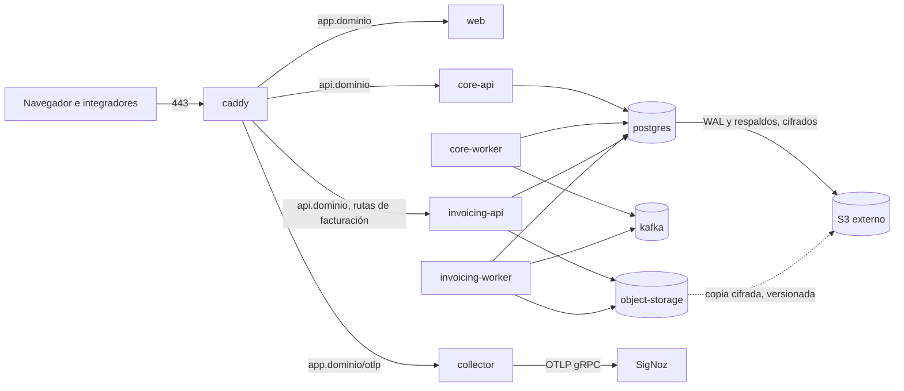

# Despliegue en producción

El stack de producción de Faclab en un VPS con Docker Compose (S8.1, ADR-0011 del core). Esta guía
lleva un servidor Ubuntu 24.04 limpio hasta el sistema funcionando, con TLS y una venta facturada en
el SRI. Desde S8.2 cubre también el despliegue continuo de versiones publicadas en GitHub Container
Registry y su reversión.

## Qué se despliega



| Servicio | Imagen | Para qué | Memoria |
|---|---|---|---|
| `caddy` | `caddy:2.11.9` con `caddy-ratelimit` (`caddy/Dockerfile`) | TLS, rutas por dominio y ruta, límites por IP y de tamaño, cabeceras de seguridad. El único con puertos publicados: 80, 443 y 443/udp | 128 MB |
| `web` | faclab-web | La aplicación (SPA), con su `config.js` escrito al arrancar | 64 MB |
| `core-api`, `core-worker` | faclab-core | El API (2 procesos de uvicorn) y el worker (outbox, consumidor de Kafka, webhooks, tareas) | 768 y 512 MB |
| `invoicing-api`, `invoicing-worker` | faclab-invoicing | El API y el worker que habla con el SRI | 384 y 512 MB |
| `postgres` | `faclab-postgres`: `postgres:17.12` con pgBackRest (`postgres/Dockerfile`) | Las bases `faclab` (core) y `faclab_invoicing`; archiva el WAL y hace los respaldos fuera del servidor ([RESPALDOS.md](RESPALDOS.md)) | 1,5 GB |
| `kafka` | `confluentinc/cp-kafka:7.9.0` | KRaft, un nodo, solo en la red interna | 1 GB |
| `kafka-topics` | la de Kafka | Crea los tópicos y termina | — |
| `object-storage` | `dxflrs/garage:v2.4.1` | XML, RIDE y logos de facturación (compatible con S3, D-2) | 256 MB |
| `collector`, `docker-socket-proxy` | `otel/opentelemetry-collector-contrib:0.165.0` | Telemetría de los servicios y del navegador, métricas de infraestructura, envío a SigNoz | 512 MB |
| `core-migrate`, `invoicing-migrate` | las de core e invoicing | Migraciones, como tareas únicas (perfil `tasks`) | — |
| `objects-backup` | `rclone/rclone:1.76.0` | Copia cifrada del almacenamiento de objetos fuera del servidor, como tarea (perfil `tasks`, [RESPALDOS.md](RESPALDOS.md)) | 256 MB |

Archivos de esta carpeta:

| Archivo | Qué es |
|---|---|
| `compose.yaml` | El stack. Usa además `scripts/create-topics.sh`, `scripts/init-invoicing-db.sh`, `garage/garage.toml` y `observability/otel-collector/config.yaml` de la raíz del repositorio |
| `versions/staging.env`, `versions/production.env` | La versión de faclab-infra, core, invoicing y web que corre cada entorno (S8.2). Cambiarla es un PR |
| `COMPATIBILITY.md` | La matriz de compatibilidad: qué publica, acepta y requiere cada versión |
| `caddy/` | La imagen de Caddy (la publica el release de faclab-infra), el `Caddyfile` y los dos modos de TLS |
| `postgres/` | La imagen de PostgreSQL con pgBackRest (la publica el release de faclab-infra) y `pgbackrest.conf` (S8.3) |
| `RESPALDOS.md` | Respaldos y recuperación: qué, dónde y cuándo, RPO y RTO, restauración y simulacro (S8.3) |
| `systemd/` | Los timers de los respaldos, que instala `scripts/backups.sh` |
| `drill/` | El sustituto de S3 de staging y de los simulacros, en la Mac (`standin.sh`) |
| `otel-collector.yaml` | Lo que cambia del Collector en producción (una sola instancia de PostgreSQL, `health_check`) |
| `env/staging.env`, `env/production.env.example` | La configuración de cada entorno que no es secreta |
| `secrets.env.example`, `sops.yaml.example` | Los nombres de los secretos y el formato de `.sops.yaml`, sin valores |
| `scripts/provision-vps.sh` | Prepara el servidor |
| `scripts/secrets.sh` | Genera, edita y envía los secretos (en tu máquina) |
| `scripts/deploy.sh` | Despliega un entorno o lo revierte (en tu máquina o en el workflow `Deploy`) |
| `scripts/remote.sh` | La entrada del servidor para `deploy.sh`: el comando forzado de la llave del CI |
| `scripts/stack.sh` | Despliega, revierte, migra, levanta, restaura y revisa el stack (en el servidor) |
| `scripts/backups.sh` | Respaldos, copia de comprobantes, su estado y sus métricas (en el servidor, desde los timers) |
| `scripts/objects-backup.sh` | La copia de objetos dentro de la tarea `objects-backup` |
| `scripts/compat.py` | Comprueba una combinación de versiones contra la matriz |
| `scripts/smoke.sh` | Prueba de humo desde fuera |
| `scripts/ci-validate.sh` | Lo que valida el CI, sin servidor |

### Decisiones

- **Dominios (D-9).** `app.<dominio>` sirve la web y `/otlp`; `api.<dominio>` sirve el core y manda a
  faclab-invoicing `/api/v1/invoices*`, `/api/invoices*`, `/api/invoicing*`, `/api/certificates*`,
  `/api/company-config*` y `/api/sequences*`. La documentación pública queda en
  `api.<dominio>/docs/public`. Al ser subdominios del mismo dominio, la cookie de sesión
  (`SameSite=Strict`) funciona.
- **Una sola instancia de PostgreSQL** con dos bases, cada una con sus roles: `faclab_owner`,
  `faclab_app`, `faclab_worker` y `faclab_monitor` en `faclab` (los crea `db_roles` del core);
  `faclab_invoicing` en `faclab_invoicing`.
- **Kafka sin TLS ni SASL, solo en la red interna** `data`: sin puertos publicados ni kafka-ui. Basta
  mientras Kafka no salga del servidor (G-49).
- **Imágenes publicadas** (S8.2): cada repositorio publica la suya en GitHub Container Registry al
  etiquetar una versión, para amd64 y arm64. El servidor las descarga y las fija por digest; no
  construye nada.
- **Respaldos fuera del servidor** (S8.3, [RESPALDOS.md](RESPALDOS.md)):
  - PostgreSQL con pgBackRest: WAL continuo, un completo semanal y un incremental diario, cifrados,
    a un bucket externo;
  - los comprobantes, copiados con cifrado a otro bucket con versionado y Object Lock durante el plazo
    legal;
  - alertas si fallan o se atrasan.

## Requisitos

- **Servidor:** Ubuntu 24.04 LTS, 4 vCPU, 8 GB de RAM y 80 GB de disco, con IPv4 pública y acceso
  root por SSH o consola la primera vez.
- **Dominio:** dos registros A, `app.<dominio>` y `api.<dominio>`, hacia la IP del servidor.
- **Tu máquina:** `ssh`, `sops`, `age` y un OpenSSL que genere llaves Ed25519 (en macOS:
  `brew install sops age openssl@3`; el OpenSSL del sistema es LibreSSL y no las genera).

## 1. Aprovisionar el servidor

Como root en el servidor, una sola vez (es idempotente):

```bash
curl -fsSLO https://raw.githubusercontent.com/faclab-ec/faclab-infra/master/deploy/production/scripts/provision-vps.sh
less provision-vps.sh   # léelo antes de correrlo
bash provision-vps.sh deploy "ssh-ed25519 AAAA... tu-llave"
```

Desde tu máquina también puedes pasarlo por stdin, sin descargarlo:
`ssh root@<ip> bash -s -- deploy "$(cat ~/.ssh/id_ed25519.pub)" < scripts/provision-vps.sh`.

Lo que hace:

- crea el usuario `deploy` con tu llave, `sudo` sin contraseña y el grupo `docker`;
- SSH solo con llave y sin root;
- ufw: entra solo 22, 80, 443 y 443/udp;
- actualizaciones de seguridad automáticas, sin reinicios automáticos;
- Docker Engine y el plugin de Compose desde el repositorio de Docker, con logs rotados y
  `mirror.gcr.io` como espejo de Docker Hub (`DOCKER_REGISTRY_MIRROR=` lo quita);
- los búferes UDP que pide HTTP/3;
- `/opt/faclab` para el repositorio y `/etc/faclab` (root, 0700) para los secretos.

Comprueba, desde otra terminal y antes de cerrar la sesión de root, que entras como `deploy` y que
root ya no entra.

> **Docker Hub.** Sin cuenta, Docker Hub da 10 descargas por hora a cada IP. En S8.1 la primera
> instalación necesitaba una docena de imágenes, y en staging agotó el límite a la mitad. El espejo de
> Google resuelve la mayoría, y lo que no tiene sale de Docker Hub. Desde S8.2 las imágenes propias
> vienen de GHCR, sin ese límite; las de terceros (PostgreSQL, Kafka, Garage, el Collector) siguen
> pasando por Docker Hub.
>
> Si aun así se agota, espera una hora y repite el despliegue (sigue donde quedó), o entra con una
> cuenta de Docker Hub en el servidor (`sudo docker login`, 100 descargas por hora).

> **Docker y ufw.** Docker escribe sus propias reglas de iptables para los puertos publicados, antes
> que las de ufw: ufw no los filtra. Lo que mantiene cerrado lo demás es que solo `caddy` publica
> puertos; `nmap` lo comprueba en la prueba de humo.

Como `deploy`, clona este repositorio:

```bash
git clone https://github.com/faclab-ec/faclab-infra.git /opt/faclab/faclab-infra
```

## 2. DNS

- Dos registros **A** hacia la IP del servidor: `app.<dominio>` y `api.<dominio>`.
- **Sin AAAA.** Con IPv6, el proxy de Docker cambia la IP de origen de cada cliente por la suya: todos
  compartirían el límite por IP de Caddy y el bloqueo de login por IP del core.
- Caddy pide los certificados a Let's Encrypt cuando arranca: los registros tienen que resolver antes.

## 3. Secretos

Los secretos viven cifrados con [sops](https://github.com/getsops/sops) y
[age](https://github.com/FiloSottile/age) **fuera de este repositorio** (es público): un archivo por
entorno en una carpeta tuya (`FACLAB_SECRETS_DIR`), que puede ser un repositorio privado. Se descifran
en tu máquina y llegan al servidor por SSH; el servidor no necesita sops ni la llave de age.

| En el servidor | Dueño y modo | Qué lleva | Quién lo lee |
|---|---|---|---|
| `/etc/faclab/secrets.env` | root, 0600 | Contraseñas de las bases, clave de certificados, llaves de Garage, SMTP, llaves y frases de cifrado de los respaldos | `docker compose` (interpolación) |
| `/etc/faclab/secrets/postgres_password` | root, 0400 | La contraseña del superusuario | El entrypoint de postgres y `stack.sh` |
| `/etc/faclab/secrets/jwt_private_key.pem` | 10001, 0400 | La llave Ed25519 que firma los tokens | core (`JWT_PRIVATE_KEY_FILE`) |
| `/etc/faclab/secrets/secret_encryption_keys` | 10001, 0400 | Las llaves Fernet de los secretos de webhooks | core (`SECRET_ENCRYPTION_KEYS_FILE`) |

- Los tres archivos de `secrets/` se montan como Docker secrets. Compose fuera de Swarm los monta tal
  cual, sin cambiar dueño ni modo: por eso cada uno pertenece al usuario que lo lee (10001 es el
  usuario de las imágenes de core e invoicing).
- Lo demás entra como variable de entorno, porque core solo lee esos archivos e invoicing ninguno. Esas
  variables se ven con `docker inspect` en el servidor (solo root y el grupo `docker`), nunca en una
  imagen ni en el repositorio.
- El superusuario de PostgreSQL no está en las variables de ningún servicio: `stack.sh` arma
  `DATABASE_URL_ADMIN` solo para la corrida de `db_roles`.

### La primera vez

En tu máquina:

```bash
export FACLAB_SECRETS_DIR=~/.config/faclab/secrets    # o la carpeta de tu repositorio privado
export SOPS_AGE_KEY_FILE=~/.config/faclab/age.key
mkdir -p "$FACLAB_SECRETS_DIR"
age-keygen -o "$SOPS_AGE_KEY_FILE"                    # tu llave: respáldala fuera de esta máquina
cp deploy/production/sops.yaml.example "$FACLAB_SECRETS_DIR/.sops.yaml"
# en .sops.yaml, deja tu llave pública (age-keygen -y "$SOPS_AGE_KEY_FILE") y la de quien más deba descifrar
```

Perder la llave de age es perder los secretos cifrados (los del servidor siguen funcionando, pero no
se pueden volver a generar iguales). Guárdala en un gestor de contraseñas o un medio aparte.

### Por entorno

```bash
deploy/production/scripts/secrets.sh init production    # genera todo, cifrado
deploy/production/scripts/secrets.sh edit production    # completa SMTP_USER y SMTP_PASSWORD
deploy/production/scripts/secrets.sh push production deploy@<servidor>
```

Y en el servidor, como `deploy`:

```bash
cd /opt/faclab/faclab-infra
sudo deploy/production/scripts/stack.sh install-secrets production
```

- `init` genera las contraseñas en hex (van en URLs sin escapar), la llave Ed25519, la llave Fernet, la
  clave de certificados y las llaves de Garage.
- `push` descifra en memoria y escribe en `~/.faclab-incoming` del servidor (umask 077); nunca escribe
  nada descifrado en tu disco. Con `FACLAB_SSH` cambias el comando (`ssh -p 2222`, `ssh -F archivo`).
- `install-secrets` los mueve a `/etc/faclab` con su dueño y modo, borra `~/.faclab-incoming` y recuerda
  el entorno (`/etc/faclab/environment`).
- `secrets.sh names <entorno>` lista los nombres sin valores.
- `secrets.sh set <entorno> <nombre> <tipo>` reemplaza un secreto por un valor nuevo de ese tipo sin
  abrir un editor. Sin tipo, lee el valor de stdin (por ejemplo, la contraseña SMTP del proveedor).

## 4. Configuración del entorno

En el servidor:

```bash
cp deploy/production/env/production.env.example deploy/production/env/production.env
```

Completa los valores `<...>` y los dominios:

- un `KAFKA_CLUSTER_ID` nuevo;
- la telemetría (S8.6): `TELEMETRY_EXPORTER=nop` hasta que haya un SigNoz; cuando lo haya, su receptor;
- el SMTP (D-3): proveedor, remitentes, y SPF, DKIM y DMARC del dominio;
- el RUC del proveedor del sistema;
- el almacenamiento externo de los respaldos: endpoint, región y los dos buckets
  ([RESPALDOS.md](RESPALDOS.md#preparar-el-almacenamiento-externo)).

Nada de esto es secreto. Cada variable que lee `compose.yaml` aparece allí con su valor por defecto.

## 5. Primera instalación

Las versiones que corre cada entorno están en `versions/<entorno>.env`, versionado en este
repositorio. Desde tu máquina, con tu llave:

```bash
FACLAB_SSH="ssh deploy@<servidor>" deploy/production/scripts/deploy.sh production
```

Es el mismo despliegue que cualquier otro ([Despliegue continuo](#despliegue-continuo)). La primera
vez no hay versión anterior: si algo falla, lo dice y no revierte nada.

1. **Checkout de faclab-infra** en el tag de `INFRA_VERSION`.
2. **Imágenes:** las cinco propias desde GHCR (con el Caddy y el PostgreSQL de faclab-infra), fijadas
   por digest, y las de terceros.
3. **`migrate`:**
   1. PostgreSQL;
   2. el rol y la base de invoicing (`init-invoicing-db.sh`);
   3. los roles y la base del core (`db_roles`, con el superusuario solo en esa corrida);
   4. las migraciones del core (como `faclab_owner`) y las de invoicing;
   5. con `BACKUPS=on`, el stanza de pgBackRest en el repositorio externo y el archivo de WAL
      encendido (`ALTER SYSTEM`; la primera vez reinicia PostgreSQL).
4. **Servicios en orden,** cada grupo sano antes del siguiente:
   - infra: PostgreSQL, Kafka y sus tópicos, Garage, el Collector y Caddy;
   - invoicing;
   - core;
   - web.
5. **Comprobaciones:**
   - Caddy enruta los dos dominios;
   - cada contenedor corre su versión;
   - 20 segundos después, nada se reinició.
6. **Respaldos:** con `BACKUPS=on`, los timers y, si el repositorio está vacío, el primer completo.

Sobre un servidor ya aprovisionado, el primer despliegue en la VM de staging tardó 3 minutos,
descargas incluidas. La instalación de S8.1, que construía las imágenes en el servidor, tardaba 8.

## 6. Prueba de humo

Desde tu máquina, contra el dominio real:

```bash
deploy/production/scripts/smoke.sh app.<dominio> api.<dominio> --rate-limit
```

Comprueba:

- TLS y la redirección de 80 a 443;
- las cabeceras de seguridad;
- `config.js`;
- que `/otlp` acepta un span de faclab-web y rechaza más de 1 MiB;
- el JWKS;
- que cada ruta llega a su servicio: sin token, core e invoicing responden 403 `PERMISSION_DENIED`, y
  el `Content-Type` dice cuál fue;
- que `/health` no es público;
- el límite de 2 MiB del API;
- con `--rate-limit`, el 429 de la zona de login (esa IP espera un minuto para entrar).

**Puertos.** Desde fuera, `nmap -Pn -p- <ip>` debe mostrar solo 22, 80 y 443, y
`sudo nmap -sU -p 443,4317,4318 <ip>` solo 443 (abierto o filtrado).

**Venta y factura.** En el navegador, en `https://app.<dominio>`:

1. Crea la empresa con `make provision-tenant` del core, desde la imagen:
   ```bash
   sudo deploy/production/scripts/stack.sh compose run --rm --no-deps core-migrate \
     python -m src.tenancy.provision --ruc ... --legal-name ... --admin-username ... --admin-email ...
   ```
   Necesita `PROVISION_ADMIN_PASSWORD`: pásala con `-e PROVISION_ADMIN_PASSWORD`, exportada en el
   shell, nunca en la línea de comandos.
2. Entra con ese usuario.
3. En Facturación, configura el emisor en el **ambiente de pruebas** del SRI y sube su certificado.
4. Abre turno en la caja, haz una venta con factura y espera a que la factura quede **AUTORIZADA** y
   el RIDE se pueda descargar. Eso prueba Kafka, el SRI y Garage.

## Operación

```bash
sudo deploy/production/scripts/stack.sh status              # contenedores y Collector
sudo deploy/production/scripts/stack.sh logs core-worker    # sigue los logs
sudo deploy/production/scripts/stack.sh compose ps          # cualquier comando de compose
```

- **Una versión nueva o volver a la anterior:** [Despliegue continuo](#despliegue-continuo) y
  [Reversión](#reversión).
- **Qué corre y qué corrió:** `stack.sh deployments` (también `deploy.sh <entorno> deployments`).
- **Un cambio de configuración** (`env/` o `secrets.env`): `stack.sh up` recrea los servicios cuya
  configuración cambió.
- **Un archivo de `/etc/faclab/secrets` cambiado:** Compose no lo detecta. Recrea a quien lo monta:
  `stack.sh compose up -d --force-recreate core-api core-worker`.
- **La configuración de Caddy** se recarga sin cortar: `stack.sh compose exec caddy caddy reload
  --config /etc/caddy/Caddyfile`.
- **Respaldos:** `sudo deploy/production/scripts/backups.sh status`, y la guía en
  [RESPALDOS.md](RESPALDOS.md).
- **Latidos y sondeos:** `sudo deploy/production/scripts/heartbeats.sh status` dice qué comprobación
  falla ahora; la guía, en [Latidos y sondeos](#latidos-y-sondeos).
- **Kafka y PostgreSQL** no se exponen. Para mirarlos:
  - `stack.sh compose exec kafka kafka-topics --bootstrap-server localhost:9092 --list`;
  - `stack.sh compose exec postgres psql -U postgres`.

## Latidos y sondeos

Producción arranca **sin telemetría** (`TELEMETRY_EXPORTER=nop`, [README de la raíz](../../README.md#en-producción)):
no hay SigNoz hasta que se decida D-1. Las alertas de SigNoz no existen en ese estado, y lo que no puede
fallar en silencio con clientes reales (S8.6) lo vigilan dos cosas que no dependen de él:

- **Sondeos HTTP desde fuera** (un servicio externo, configurados a mano): detectan que algo no responde.
- **Latidos desde el servidor** (`scripts/heartbeats.sh`, un timer de systemd por comprobación, cada 5
  minutos): detectan lo que desde fuera no se ve. Cada uno avisa al servicio de latidos si todo está
  bien (`<base>/faclab-<comprobación>`) o si falla (`…/fail`, con el motivo). El servicio alerta con un
  `fail` y también cuando los latidos dejan de llegar: un servidor caído, un timer detenido.

### Qué se vigila

| Latido (slug) | Falla cuando | Qué hacer |
|---|---|---|
| `faclab-stack` | un contenedor no corre, está `unhealthy` o se reinicia (los de una sola corrida deben haber salido con 0) | `stack.sh status` y `stack.sh logs <servicio>` |
| `faclab-backup` | un respaldo está atrasado o falló, o el archivado del WAL falla (lo que mira `backups.sh`: mismas reglas que `respaldo-atrasado`, `respaldo-fallido` y `wal-sin-archivar`). Con `BACKUPS=off` no envía nada | [respaldos](../../observability/runbooks/respaldos.md) |
| `faclab-outbox` | el outbox tiene mensajes `failed` (`outbox-failed`) | [mensajes fallidos](../../observability/runbooks/mensajes-fallidos.md) |
| `faclab-disk` | el disco de Docker supera el 80 % | [disco](../../observability/runbooks/disco.md) |

Los sondeos externos, con el dominio de cada entorno (`/health/*` da 404 desde fuera a propósito: la
salud la ven `docker` y el latido `faclab-stack`):

| Sondeo | Espera | Qué prueba |
|---|---|---|
| `https://app.<dominio>/` | 200 | Caddy, su certificado y la web |
| `https://api.<dominio>/.well-known/jwks.json` | 200 | el core responde (las claves públicas que verifica facturación) |
| `https://api.<dominio>/api/v1/invoices` | 401 | facturación responde (sin token contesta 401) |
| El certificado TLS de `app.` y `api.` | vence en más de 14 días | que Caddy renueve |

### Ponerlos en marcha

1. En el servicio de latidos (Healthchecks.io o uno que acepte pings por nombre con la llave del
   proyecto), crear los cuatro checks con esos *slugs*, período de 5 minutos, margen (*grace*) de 10, y
   como canales el correo y el bot de Telegram.
2. Guardar la URL base con la llave del proyecto, que es un secreto (`https://hc-ping.com/<llave>`):
   ```bash
   printf '%s' 'https://hc-ping.com/<llave>' | scripts/secrets.sh set <entorno> HEARTBEAT_BASE_URL
   scripts/secrets.sh push <entorno> <usuario@servidor>     # y en el servidor: stack.sh install-secrets
   ```
3. `stack.sh deploy` (o `heartbeats.sh install-timers`) instala y habilita los timers cuando la URL
   existe, y los quita cuando se vacía. Comprobar:
   ```bash
   sudo deploy/production/scripts/heartbeats.sh status       # qué dice cada comprobación, sin enviar
   systemctl list-timers 'faclab-heartbeat@*'
   journalctl -u faclab-heartbeat@stack
   ```
4. En el servicio de sondeos, crear los de la tabla con aviso por correo y Telegram.

Ni el script ni los timers imprimen la URL: curl la lee por la entrada estándar y descarta su respuesta.
Antes de depender de un plan gratuito, leer sus términos: algunos lo limitan a uso personal.

### Prueba controlada

- Un fallo: `stack.sh compose stop core-worker`. En 5 minutos `faclab-stack` avisa con `fail` y el
  nombre del servicio; `stack.sh compose start core-worker` lo resuelve.
- Silencio: `systemctl stop faclab-heartbeat@stack.timer`. A los 10 minutos de margen, el servicio
  avisa de que no llegan latidos; `systemctl start …` lo resuelve.
- Sin servidor: `scripts/test-heartbeats.sh` prueba cada comprobación contra un receptor local
  (lo corre `ci-validate.sh`).

### Lo que no cubren

Sin SigNoz no se ven: facturas atascadas o certificados de firma por vencer (hay que leer las tablas de
negocio y `faclab_monitor` solo ve estadísticas), la tasa de errores 5xx, la latencia del POS ni las
trazas. Son los que vuelven con la telemetría. Mientras tanto: `make outbox-failed`,
`make dead-letters` y `GET /api/admin/invoice-discrepancies` en faclab-core, a mano.

## Despliegue continuo

Desde S8.2 una versión es un tag `vX.Y.Z` de cada repositorio (CHANGELOG en cada uno).

**Qué produce cada tag.** Su workflow `release.yml` publica la imagen en GitHub Container Registry,
para amd64 y arm64:

| Repositorio | Imagen |
|---|---|
| faclab-core | `ghcr.io/faclab-ec/faclab-api` |
| faclab-invoicing | `ghcr.io/faclab-ec/faclab-invoicing` |
| faclab-web | `ghcr.io/faclab-ec/faclab-web` |
| faclab-infra | `ghcr.io/faclab-ec/faclab-caddy`, el Caddy de entrada, y `ghcr.io/faclab-ec/faclab-postgres`, PostgreSQL con pgBackRest (S8.3); además, el stack de su tag |

La imagen lleva la versión en `SERVICE_VERSION` (el `service.version` de logs y trazas) y en la
etiqueta `org.opencontainers.image.version`. Los paquetes son públicos, así que el servidor descarga
sin credenciales; los repositorios también lo son, y S8.1 comprobó que las imágenes no llevan
secretos.

**Qué corre cada entorno.** `versions/staging.env` y `versions/production.env` lo dicen.

1. **Cambiar una versión es un PR.** El CI de este repositorio lo rechaza si la combinación no está en
   la [matriz de compatibilidad](COMPATIBILITY.md). Al publicar una versión, su fila se agrega en ese
   mismo PR.
2. **Después del merge, se despliega:**
   - desde el workflow `Deploy` de este repositorio (Actions → Deploy → Run workflow, entorno y
     `deploy`);
   - o desde tu máquina, con `FACLAB_SSH="ssh deploy@<servidor>" deploy/production/scripts/deploy.sh <entorno>`.

   Producción solo acepta versiones finales; staging, también prereleases (`0.2.0-rc.1`).

**Lo que hace `deploy.sh`.** Antes de tocar el servidor:

- valida el formato;
- comprueba la matriz (`compat.py`);
- comprueba que las cuatro imágenes de las versiones estén publicadas.

Después llama por SSH a `remote.sh`, que corre `stack.sh deploy` con esas versiones. Con un `flock`,
un despliegue a la vez:

1. **Checkout** de faclab-infra en `v<INFRA_VERSION>`, y continúa el `stack.sh` de esa versión.
2. **Imágenes:** las descarga y las fija por digest en `/etc/faclab/deployments/target.env`. Si una
   falla, nada cambió.
3. **Respaldo:** `pg_dump` de las dos bases en `/var/backups/faclab/predeploy/<id>/` (root, 0600),
   con las versiones que corrían. Se conservan los últimos 5. No reemplaza los respaldos de S8.3.
4. **Esquema hacia atrás**, si la versión de destino es más vieja que la base: `alembic downgrade` y
   `node-pg-migrate down`, con las imágenes que conocen esas migraciones.
5. **Migraciones** (`migrate`).
6. **Servicios en orden:** infra → invoicing → core → web. Cada grupo con `up --wait` y su salud
   desde la red interna (Collector `:13133`, invoicing `/health`, core `/health/ready`, web
   `/health`).
7. **Comprobaciones:**
   - el JWKS y `config.js` a través de Caddy;
   - la etiqueta de versión de cada contenedor;
   - 20 segundos sin reinicios ni contenedores `unhealthy` (`DEPLOY_SOAK_SECONDS`).
8. **Resultado:**
   - **si todo pasa,** `current.env` pasa a `previous.env`, el destino a `current.env`, queda una línea
     en `history.log`, se borran las imágenes que no son ni la actual ni la anterior y, con
     `BACKUPS=on`, se instalan los timers de los respaldos;
   - **si algo falla desde el paso 4,** [reversión automática](#reversión).

Cada paso muestra su hora. Códigos de salida de `deploy.sh`, `remote.sh` y `stack.sh deploy`:

| Código | Qué significa |
|---|---|
| 0 | Desplegado |
| 3 | Falló y se revirtió solo: corren las versiones de antes |
| Otro | Falló sin revertir (sin versión anterior, o la reversión también falló): lee el log |

Cada servicio que cambia se reinicia, con un corte breve (ADR-0011). Entre las migraciones y la
actualización de core, la versión anterior corre unos segundos sobre el esquema nuevo: por eso las
migraciones deben ser aditivas ([abajo](#migraciones)).

### El workflow `Deploy` y la llave del CI

El workflow (`.github/workflows/deploy.yml`) corre `deploy.sh` desde `master`, a mano, por entorno, y
espera a que termine el despliegue anterior de ese entorno. Su llave solo puede correr `remote.sh`.

**1. Una llave por entorno,** sin contraseña y fuera de este repositorio:

```bash
ssh-keygen -t ed25519 -N '' -C faclab-ci-production -f ~/.config/faclab/ci-production-ed25519
```

**2. Autorizarla en el servidor.** `stack.sh authorize-ci` la escribe en `authorized_keys` de `deploy`
con `restrict,command="…/remote.sh"`: sin shell, sin reenvíos, y solo `deploy <cuatro versiones>`,
`rollback`, `status` y `deployments`. Cada versión se valida contra un patrón estricto y nunca pasa
por un shell. Una llave nueva reemplaza a la anterior.

```bash
sudo deploy/production/scripts/stack.sh authorize-ci "$(cat ci-production-ed25519.pub)"
```

**3. El entorno de GitHub.** En faclab-infra, Settings → Environments, crea `staging` y `production`:

- **Secreto** `DEPLOY_SSH_KEY`: la llave privada.
- **Variables:**
  - `DEPLOY_HOST`: la IP o el nombre del servidor;
  - `DEPLOY_KNOWN_HOSTS`: la línea de `ssh-keyscan -t ed25519 <host>`, comparada con
    `ssh-keygen -lf /etc/ssh/ssh_host_ed25519_key.pub` en el servidor;
  - opcionales, `DEPLOY_PORT` y `DEPLOY_USER`.
- **En `production`:**
  - *Required reviewers* (tú), para que cada despliegue espere tu aprobación;
  - *Deployment branches*, solo `master`.

El workflow nunca desactiva la verificación de la llave del servidor (`StrictHostKeyChecking=yes`).

**Rotar la llave del CI:** genera otra, `authorize-ci` con la nueva (reemplaza la anterior) y cambia
`DEPLOY_SSH_KEY`.

## Reversión

### Automática

Si el despliegue falla en las migraciones, en un servicio, en su salud o en las comprobaciones,
`stack.sh`:

1. **Esquema:** lo baja a la revisión que conoce la versión anterior, con las imágenes nuevas (las
   únicas que tienen esas migraciones).
2. **faclab-infra:** si cambió, vuelve a su tag anterior y usa el `stack.sh` de esa versión.
3. **Servicios:** levanta la versión anterior por digest, en el mismo orden y con las mismas
   comprobaciones.
4. **Salida:** registra `rolled-back` en el historial y sale con 3.

Lo que la versión fallida escribió en las tablas o columnas que su migración agregó se pierde con la
bajada; lo demás queda.

Si la bajada del esquema falla, se detiene sin restaurar nada solo. Algunas versiones nuevas pueden
quedar corriendo. Te indica el respaldo previo: `stack.sh restore-predeploy <id> --yes`.

### A mano: un comando

```bash
deploy/production/scripts/deploy.sh <entorno> rollback       # desde tu máquina, o el workflow con action=rollback
sudo deploy/production/scripts/stack.sh rollback             # en el servidor
```

Despliega las versiones de `previous.env`, con respaldo, esquema hacia atrás, orden y comprobaciones.
Queda en el historial como `rollback`. Un segundo `rollback` vuelve a la versión de la que se salió.

Después, abre un PR que deje `versions/<entorno>.env` como lo que corre, o una versión corregida: el
archivo es lo que se desplegará la próxima vez.

### Restaurar el respaldo previo

```bash
sudo deploy/production/scripts/stack.sh backups                      # id, tamaño y versiones de cada uno
sudo deploy/production/scripts/stack.sh restore-predeploy <id> --yes
```

1. detiene las aplicaciones;
2. recrea las dos bases desde el respaldo (`pg_restore -C`: dueño, privilegios y configuración);
3. despliega las versiones que corrían al tomarlo.

Se pierde todo lo escrito desde ese respaldo. Es el camino para una migración que no se puede
revertir.

### Migraciones

**La regla para las nuevas: aditivas (expand/contract).** La migración de una versión deja funcionando
a la anterior sobre el esquema nuevo: agrega tablas, columnas nulables o con valor por defecto e
índices. Lo que quita, renombra o vuelve obligatorio va en una versión posterior, cuando ninguna
versión desplegada lo use. Así:

- el corte entre las migraciones y la actualización de core no rompe nada;
- la reversión casi nunca encuentra datos que no le caben.

**Tres clases de migración, según su vuelta atrás.** Dilo en la línea **Migraciones** del CHANGELOG de
la versión:

| Clase | Qué pasa al revertir | Ejemplos del core (anteriores a 0.1.0) | Cómo se vuelve atrás |
|---|---|---|---|
| Reversible | El `downgrade` deshace todo; pierde solo lo que la versión escribió en lo que agregó | Las que crean tablas: `924daed89837` (listas de precios), `e633ee39eaea` (cotizaciones), `e5b8c1d4a7f2` (webhooks) | La reversión, automática o a mano |
| Falla con ciertos datos | El `downgrade` se niega mientras haya datos que no caben | `734b22d691ca` (montos que no caben en 12,6), `db772159cc6b` (cantidades con decimales), `f6c2d84e1a97` (líneas en otra presentación) | Corrige o borra esos datos y repite el `rollback`, o `restore-predeploy` |
| Pierde información | El `downgrade` corre, pero no deja lo de antes | `e3b7a91c5d20` (pierde las presentaciones que no son la base), `b5e2c8d41f07` (los pagos `CREDIT` pasan a `OTHER`), `a3d9e1c47b52` (`CREDITED` vuelve a `AUTHORIZED`), `9d3f6a2c8e14` (las órdenes vuelven a IVA 0) | Prefiere una versión correctiva; si no, `restore-predeploy` |

- **Una migración sin `downgrade`** (o que lanza un error) es no reversible: la reversión se detiene
  en ella y queda `restore-predeploy`.
- **En faclab-invoicing,** cada migración tiene su `-- Down Migration`.
- **Mensajes de Kafka:** lo que una versión ya publicó se queda en los tópicos. La vuelta atrás vale
  si los consumidores siguen aceptando esa versión del contrato ([matriz](COMPATIBILITY.md); en el
  core, `contracts/CHANGELOG.md`). Un mensaje que un consumidor ya no acepta queda en su
  `dead_letters`, para reprocesarlo después.

### De S8.1 a S8.2

Un servidor instalado con S8.1 construía las imágenes desde Git (`IMAGES_FROM=git`,
`compose.build.yml`). Para pasarlo a S8.2:

1. **El checkout:**
   - `git remote set-url origin https://github.com/faclab-ec/faclab-infra.git` si no apunta a
     GitHub (la VM de staging lo tenía en un `git bundle`);
   - quita de `env/production.env` las líneas `IMAGES_FROM`, `*_REF` y `*_IMAGE`.
2. **La llave del CI,** si vas a usar el workflow: `stack.sh authorize-ci`.
3. **El primer despliegue,** con `deploy.sh <entorno>`:
   - reemplaza las imágenes construidas por las publicadas, y luego las borra;
   - no tiene versión anterior a la que volver, pero hace el respaldo previo como cualquier otro.

En staging tardó 3 minutos y la prueba de humo pasó completa.

## Rotación de secretos

Cada rotación sigue la misma forma:

1. en tu máquina, `secrets.sh set <entorno> <nombre> <tipo>`, o `secrets.sh edit <entorno>` con un
   valor de `secrets.sh generate <tipo>`;
2. `secrets.sh push <entorno> deploy@<servidor>`;
3. en el servidor, `sudo stack.sh install-secrets <entorno>`;
4. lo propio de cada secreto, abajo.

| Secreto | Tipo | Después de instalarlo |
|---|---|---|
| `CORE_DB_OWNER_PASSWORD`, `CORE_DB_APP_PASSWORD`, `CORE_DB_WORKER_PASSWORD`, `DB_MONITOR_PASSWORD` | `hex` | `stack.sh migrate` (`db_roles` cambia las contraseñas) y `stack.sh up`. Entre los dos, el servicio afectado no conecta: unos segundos |
| `INVOICING_DB_PASSWORD` | `hex` | `stack.sh migrate` (recrea postgres con la variable nueva y `init-invoicing-db.sh` cambia la contraseña) y `stack.sh up` |
| `postgres_password` (superusuario) | `hex` | `stack.sh postgres-password`: `ALTER ROLE` por stdin, sin reiniciar PostgreSQL |
| `jwt_private_key.pem` | `ed25519` | Ver abajo: la llave anterior se sigue aceptando mientras vivan sus tokens |
| `secret_encryption_keys` | `fernet` | Pon la llave nueva **primera**, separada por coma de las anteriores: la primera cifra y todas descifran. `stack.sh compose up -d --force-recreate core-api core-worker`. Quita una llave vieja solo cuando ningún secreto de webhook cifrado con ella siga en uso (rótalos con `rotate-secret`) |
| `CERTIFICATE_PASSWORD_KEY` | `base64` | **No se puede rotar todavía**: invoicing usa una sola clave y cambiarla deja ilegibles los certificados guardados. Pendiente en faclab-invoicing (una lista de claves como la de Fernet) |
| `OBJECT_STORAGE_ACCESS_KEY_ID`, `OBJECT_STORAGE_SECRET_ACCESS_KEY` | `garage-key-id`, `garage-secret` | Garage solo crea la llave de las variables en el primer arranque. Rota con su CLI: crea e importa la nueva con permiso en el bucket, instala los secretos, `stack.sh up`, y borra la anterior. Ver abajo |
| `GARAGE_RPC_SECRET`, `GARAGE_ADMIN_TOKEN` | `garage-secret`, `base64` | `stack.sh up` (reinicia Garage) |
| `SMTP_USER`, `SMTP_PASSWORD` | las del proveedor | `stack.sh up` |
| `BACKUP_PG_ACCESS_KEY_ID`, `BACKUP_PG_SECRET_ACCESS_KEY`, `BACKUP_OBJECTS_ACCESS_KEY_ID`, `BACKUP_OBJECTS_SECRET_ACCESS_KEY` | las del proveedor | `stack.sh up` (recrea `postgres`; la copia de objetos las lee en su próxima corrida). Borra la llave anterior en el proveedor después |
| `BACKUP_PG_CIPHER_PASS`, `BACKUP_OBJECTS_CRYPT_PASSWORD`, `BACKUP_OBJECTS_CRYPT_SALT` | `base64`, `hex`, `hex` | **No se rotan en el lugar**: cifran lo que ya está en los buckets. Cambiarlas exige un repositorio nuevo (otro bucket o ruta) con un completo y una copia nuevos, y conservar las anteriores mientras vivan los respaldos viejos ([RESPALDOS.md](RESPALDOS.md)) |

**Llave JWT.** Los tokens de refresco viven 7 días; la llave anterior se acepta durante ese tiempo.

1. Saca su pública, que no es secreta, antes de cambiarla:
   ```bash
   sops decrypt --extract '["files"]["jwt_private_key.pem"]' "$FACLAB_SECRETS_DIR/production.sops.yaml" |
     openssl pkey -pubout
   ```
2. Ponla en `env/production.env` del servidor, en una línea, con `\n` literales:
   `JWT_PUBLIC_KEYS='-----BEGIN PUBLIC KEY-----\nMCow...\n-----END PUBLIC KEY-----'`.
3. Pon una llave nueva (`secrets.sh set production jwt_private_key.pem ed25519`), y luego `push` e
   `install-secrets`.
4. `stack.sh compose up -d --force-recreate core-api core-worker`. El JWKS publica las dos;
   invoicing aprende la nueva al ver su `kid`.
5. Pasados 7 días, quita `JWT_PUBLIC_KEYS` y corre `stack.sh up`.

**Llave de Garage.** En el servidor, con los valores nuevos a mano:

```bash
sudo deploy/production/scripts/stack.sh compose exec object-storage /garage key import -n faclab-invoicing-2 <id> <secreto> --yes
sudo deploy/production/scripts/stack.sh compose exec object-storage /garage bucket allow --read --write --owner faclab-invoicing --key faclab-invoicing-2
# secrets.sh edit/push, install-secrets y stack.sh up; después:
sudo deploy/production/scripts/stack.sh compose exec object-storage /garage key delete --yes <id anterior>
```

**Llave de age** (quién puede descifrar): agrega o quita la pública en `$FACLAB_SECRETS_DIR/.sops.yaml`
y corre `sops updatekeys <entorno>.sops.yaml` en esa carpeta. Si alguien con acceso se va, rota además
los secretos que pudo leer.

## Recursos

Los límites de memoria (`*_MEMORY`) suman unos 5,8 GB, pensados para 4 vCPU y 8 GB. Lo medido en la
VM de staging (`docker stats`), con una empresa y una venta facturada:

| Servicio | Límite | En reposo | Después de la venta |
|---|---|---|---|
| `caddy` | 128 MB | 14 MB | 36 MB |
| `web` | 64 MB | 14 MB | 31 MB |
| `core-api` | 768 MB | 371 MB | 385 MB |
| `core-worker` | 512 MB | 100 MB | 101 MB |
| `invoicing-api` | 384 MB | 93 MB | 118 MB |
| `invoicing-worker` | 512 MB | 89 MB | 108 MB |
| `postgres` | 1,5 GB | 90 MB | 103 MB |
| `kafka` | 1 GB | 371 MB | 467 MB |
| `object-storage` | 256 MB | 4 MB | 9 MB |
| `collector` | 512 MB | 103 MB | 166 MB |
| `docker-socket-proxy` | 64 MB | 23 MB | 23 MB |
| **Total** | 5,8 GB | 1,3 GB | 1,55 GB |

- Ningún contenedor murió por memoria ni se reinició.
- Los límites dejan holgura para la carga real y para PostgreSQL, que crece con sus búferes:
  `shared_buffers` de 384 MB.

Medido bajo carga en S9.2 (informe `docs/architecture/CARGA.md` de faclab-core), en una copia de la VM
de staging con 4 vCPU:

- **Capacidad:** unas 600 ventas por minuto en el POS (150 veces el pico de la ferretería piloto) y 110
  facturas autorizadas por minuto. La CPU es lo primero que se agota.
- **Memoria:** unos 2,3 GB en total (`core-api` 480 MB, `postgres` 560 MB, `kafka` 550 MB). Los límites
  no se cambiaron.
- **`CORE_WEB_CONCURRENCY` se queda en 2** con 4 vCPU: con 4 la latencia empeoró y las conexiones
  llegaron a 144 de 150.
- **Disco:** unos 25 KB por venta facturada.
- Son cifras de referencia: hay que repetirlas en el primer VPS y ajustar los límites en
  `env/<entorno>.env` con el tráfico del piloto.

`load/compose.load.yaml` es el override de esas pruebas, solo para una copia desechable: SRI simulado,
límites por IP abiertos y telemetría apagada. Cómo se usa, en `tests/load/README.md` de faclab-core.

## Staging en una VM local

S8.1 se probó en una máquina limpia de [OrbStack](https://orbstack.dev) en una Mac.

- Se crea con `orb create ubuntu:noble faclab-staging`, y se aprovisiona con
  `orb -m faclab-staging -u root bash -s -- deploy "$(cat ~/.ssh/<llave>.pub)" < scripts/provision-vps.sh`.
- `env/staging.env` usa `app.faclab.test` y `api.faclab.test`, el TLS de la CA interna de Caddy
  (`CADDY_TLS_MODE=internal`), integraciones de prueba y el correo apagado.
- La raíz de esa CA se saca con
  `sudo stack.sh compose cp caddy:/data/caddy/pki/authorities/local/root.crt ./caddy-root.crt`.
  - Para `curl`: `--cacert caddy-root.crt` (o `smoke.sh ... --cacert caddy-root.crt`).
  - Para el navegador: confía en ella en el Llavero mientras pruebas, y quítala después.

Diferencias con un VPS real:

- **Sin DNS público ni ACME.** Los nombres van en `/etc/hosts` de quien abre la aplicación, y el
  certificado es de la CA interna.
- **La Mac llega a la VM** por la IP de la máquina (`orb list`), o por `localhost`, al que OrbStack
  reenvía los puertos de la máquina.
  - Las aplicaciones de macOS necesitan el permiso de *Red local* para la IP. Sin él, la conexión
    falla con «No route to host».
  - Los contenedores del Docker de la Mac llegan a la IP sin ese permiso: de ahí corren `nmap` y
    `smoke.sh` en la prueba.
- **No hay SigNoz propio:** el Collector de staging envía al de faclab-infra en la Mac
  (`host.orb.internal:4317`), que reenvía al SigNoz local cuando está arriba; si no, reintenta y
  descarta lo que no cabe en su cola. Con `TELEMETRY_EXPORTER=nop` en `env/staging.env` queda apagada,
  como en producción (S8.6).
- **Respaldos apagados** (`BACKUPS=off`) hasta el primer VPS. S8.3 los probó contra el sustituto de
  S3 de `drill/` en la Mac ([RESPALDOS.md](RESPALDOS.md#el-sustituto-de-staging)).
- **El workflow `Deploy` no llega a la VM,** porque no tiene IP pública: en S8.2 se desplegó desde la
  Mac con `deploy.sh` y la misma llave restringida del CI. La primera corrida del workflow queda para
  el primer VPS.

La [ficha de S8.1](https://github.com/faclab-ec/faclab-api/blob/master/docs/architecture/sessions/S8.1-stack-de-produccion-en-vps.md)
del core registra la prueba: qué se corrió, sus resultados y la memoria medida.

## Lo que falta

- **El primer VPS real:**
  - certificados de Let's Encrypt y `nmap` desde Internet;
  - la primera corrida del workflow `Deploy` y los entornos de GitHub;
  - el proveedor de correo, con SPF, DKIM y DMARC (D-3).
- **El sandbox desplegado** (`sandbox.<dominio>`) y el workflow programado de los ejemplos de la API
  contra él: necesitan un servidor público.
- **El proveedor real de los respaldos** (S8.3): staging usa el sustituto de `drill/`. Con el primer
  VPS se crean sus buckets, con Object Lock de 7 años para los comprobantes, y se repite el simulacro
  ([RESPALDOS.md](RESPALDOS.md)).
- **S8.6, lo que quedó pendiente (D-1 abierta):**
  - SigNoz de producción (VPS aparte o SigNoz Cloud) y la telemetría encendida con TLS, vista en los seis
    dashboards;
  - sus usuarios nominales y canales reales (SMTP, bot de Telegram, `ALERT_EMAIL_TO`,
    `SIGNOZ_EXTERNAL_URL`), y una alerta de prueba que llegue a ellos;
  - la telemetría propia del Collector;
  - los sondeos y latidos contra un servicio real y desde un servidor real (cuentas por crear);
  - el simulacro de restauración del metastore de SigNoz.
- **Kafka con TLS y SASL**, si alguna vez sale del servidor (G-49), e IPv6.
